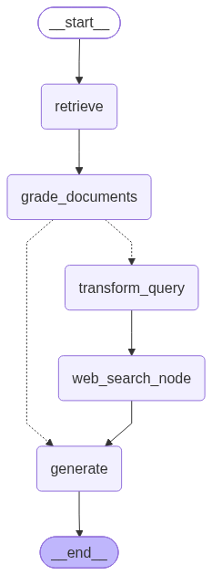

# Corrective RAG

A self-correcting Retrieval-Augmented Generation (RAG) pipeline built with **LangGraph** and **LangChain**.

Instead of trusting whatever the retriever returns, the pipeline **grades every retrieved document** for relevance to the question. If nothing relevant comes back, it **rewrites the question**, falls back to a **web search**, and only then generates the final answer.



---

## How it works

| Step | Node | What happens |
|------|------|--------------|
| 1 | `retrieve` | Fetch the top documents for the question from a FAISS vector store. |
| 2 | `grade_documents` | An LLM grader scores each document `yes` / `no` for relevance. Irrelevant docs are dropped. |
| 3 | `decide_to_generate` | Conditional edge: if any document was irrelevant, go to `transform_query`; otherwise go straight to `generate`. |
| 4 | `transform_query` | An LLM re-writes the question to be better suited for web search. |
| 5 | `web_search_node` | Tavily search runs on the rewritten question; results are appended to the document set. |
| 6 | `generate` | The RAG chain answers the question using the (now trustworthy) context. |

### Graph

```
START → retrieve → grade_documents ─┬─(relevant)──────────────→ generate → END
                                    └─(not relevant)→ transform_query → web_search_node → generate
```

---

## Project structure

```
.
├── Graph.py           # StateGraph definition, nodes, edges, compiled `app`
├── Node.py            # Retriever, grader, RAG chain, question rewriter, search tool
├── app.png            # Auto-generated graph visualization
├── requirements.txt   # Python dependencies
└── README.md
```

### `Node.py`
Builds every building block:

- **Retriever** — loads three of Lilian Weng's blog posts with `WebBaseLoader`, splits them into 500-character chunks (`RecursiveCharacterTextSplitter`), embeds them with `sentence-transformers/all-MiniLM-L6-v2`, and indexes them in FAISS.
- **`retrieval_grader`** — a `ChatPromptTemplate` piped into the LLM with structured output (`GradeDocuments.binary_score`), returning `yes` / `no`.
- **`rag_chain`** — the public `rlm/rag-prompt` pulled from LangSmith, piped through the LLM and a `StrOutputParser`.
- **`question_rewriter`** — rewrites a question to be optimised for web search.
- **`web_search_tool`** — `TavilySearchResults(k=3)`.

### `Graph.py`
Defines the `Graphstate` typed dictionary (`question`, `generation`, `web_search`, `documents`), implements the node functions, wires up the conditional edge, and compiles the graph as `app`.

---

## Setup

### 1. Install dependencies

```bash
pip install -r requirements.txt
```

### 2. Configure environment variables

Create a `.env` file in the project root:

```env
GROQ_API_KEY=your_groq_api_key
TAVILY_API_KEY=your_tavily_api_key
LANGCHAIN_API_KEY=your_langsmith_api_key   # optional, for the rlm/rag-prompt
LANGCHAIN_TRACING_V2=true                  # optional
```

Get keys from:
- Groq — https://console.groq.com/keys
- Tavily — https://app.tavily.com/
- LangSmith — https://smith.langchain.com/

### 3. Run

```bash
python Graph.py
```

On first run, the documents are scraped and embedded (this downloads the embedding model and takes a minute or two). The graph image is written to `app.png`, then the compiled graph is invoked with the sample question:

```
What are the types of agent memory?
```

The result is printed as a state dictionary containing the final `generation`.

---

## Customising

- **Change the question** — edit the `app.invoke({...})` call at the bottom of `Graph.py`.
- **Change the knowledge base** — edit the `urls` list in `Node.py`, or swap the `WebBaseLoader` block for a PDF/CSV/DB loader.
- **Change the model** — modify the `ChatGroq(model=...)` line in `Node.py`.
- **Tune chunking** — adjust `chunk_size` / `chunk_overlap` in the `RecursiveCharacterTextSplitter`.
- **Tune web search depth** — change `k` in `TavilySearchResults(k=3)`.

---

## Tech stack

LangGraph · LangChain · Groq (`openai/gpt-oss-120b`) · HuggingFace embeddings · FAISS · Tavily · LangSmith
